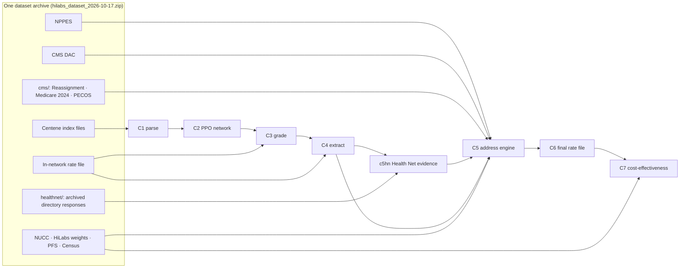

# HiLabs Provider Rates — Centene CA Commercial PPO

**A re-runnable, streaming data pipeline that turns Centene's raw Transparency-in-Coverage (TiC) files into a trustworthy provider rate file: one row per NPI × TIN × billing code × verified practice address.**

Built for the HiLabs *Data Pipeline Curation for Provider Rates* hackathon (AI Quest). Scope: **Centene · California · Commercial group · PPO**, Type 1 and Type 2 NPIs.

**🎥 [Video walkthrough](https://vimeo.com/1237029700) · 📦 [Dataset archive (Google Drive)](https://drive.google.com/drive/folders/1qnCJsUgaENz8kRgMfdi7QzWZGBIhKM8o?usp=sharing) · 🖥️ [Source code](https://github.com/sivk-kex/hilabs)**

```text
Centene index files ─► C1 parse ─► C2 PPO network ─► C3 grade files ─► C4 extract rates
                                                                            │
   NPPES · CMS · Health Net directory · Medicare claims · PECOS ─► C5 address engine
                                                                            │
                                            C6 final rate file ─► C7 cost-effectiveness
```

> **Every number in this README comes from a pipeline run or a stage manifest (`data/stage/<stage>/_manifest.json`). None is typed by hand.** Where a number comes from an analysis rather than the latest full run, its date and source are stated.

---

## Table of contents

1. [Results at a glance](#1-results-at-a-glance)
2. [The problem](#2-the-problem)
3. [Architecture](#3-architecture)
4. [Quickstart](#4-quickstart)
5. [Data sources](#5-data-sources)
   - [5.1 Provided by the problem statement](#51-provided-by-the-problem-statement)
   - [5.2 Sources we added beyond the PS — and why they matter](#52-sources-we-added-beyond-the-ps--and-why-they-matter)
6. [Data acquisition challenges](#6-data-acquisition-challenges)
7. [Methodology by challenge](#7-methodology-by-challenge)
   - [C1–C2 · PPO network](#c1c2--finding-the-ppo-network)
   - [C3 · File quality grading](#c3--grading-ptd-files)
   - [C4 · Rate extraction](#c4--extracting-rates)
   - [C5 · Address engine (heuristic scoring)](#c5--the-address-engine-heuristic-scoring)
   - [C6 · Final rate file](#c6--final-rate-file)
   - [C7 · Cost-effectiveness](#c7--cost-effectiveness-brownie-point)
8. [AI models: NLP fallback and RAG copilot](#8-ai-models-nlp-fallback-and-rag-copilot)
9. [Deliverables map](#9-deliverables-map)
10. [Engineering principles](#10-engineering-principles)
11. [Repository layout](#11-repository-layout)
12. [Known limitations](#12-known-limitations)

---

## 1. Results at a glance

| Stage | Measured result | Source |
|---|---|---|
| **C1** Index parsing | **3,274** plan → rate-file rows from all 11 Centene index files, deduplicated to **33** unique rate files | `stage/c1/_manifest.json` |
| **C2** PPO network | **453** CA commercial-group PPO plans → **1** physical rate file (Health Net CA, shared by 1,312 CA plans) | `stage/c2/_manifest.json` |
| **C3** File quality | Health Net CA in-network file graded **92.9 / 100 (A)** over **1,500,288** prices; 0 % duplicates, 0 % $0/negative, 99.91 % valid NPIs | `docs/deliverables/file_quality_metrics.md` |
| **C4** Rate extraction | **1,717** services → **1,511,720** price records → **21,853** curated NPI×TIN×code rates; **3,734** NPIs, **2,888** TINs; 12,732 exact duplicates removed; 0 unresolved provider references | `stage/c4/c4_summary.json` |
| **C5** Health Net directory | **3,734** NPIs searched, **0** errors; **78.2 %** found in Health Net's commercial PPO; **62.0 %** have their address confirmed by Health Net | `stage/c5_healthnet/_manifest.json` (2026-10-18) |
| **C6** Address verification | Rows with ≥ 2 independent sources agreeing on the address: **4.8 % → 25.0 %** (strong sources) / **57.1 %** (incl. hidden payer listings) | offline analysis of the C6 file, 2026-10-18 |
| **C7** Cost-effectiveness | 3,008 providers scored against Medicare-anchored, locality-adjusted peers; 336 honestly marked *Insufficient data* | in-memory run on the C6 file, 2026-10-18 |

### Plots for insights

**C2: how 3,274 Centene plans narrow to 453 CA commercial-group PPO plans (every bar is a rule ID)**


**C2: why rules decide. NLP embedding scores max out at 0.418, so no plan ever reaches the 0.8 threshold**


**C3: file-quality scorecard for the Health Net CA file (92.9, A); code coverage is the one weak dimension**


**C4: from 1,717 services to 21,853 curated rates (log scale)**


**C5: the heuristic address-scoring weights; no single non-CMS source reaches VERIFIED alone**


**C6: what verifies each final row; payer and claims evidence lifts verification from 4.8 % to 25.0 % (strong) / 57.1 % (total)**


**C7: providers by price-vs-peers × breadth quadrant**


---

## 2. The problem

Payers publish negotiated rates as TiC machine-readable files, but those rates are **hard to trust** (duplicates, $0 rates, stale contracts, missing codes) and **hard to place** (rates are keyed only by NPI and TIN, with no specialty or address). The problem statement adds that **about 80 % of NPPES addresses are stale or wrong**, so the registry cannot be the answer on its own.

| Core problem | Challenges |
|---|---|
| Network mapping | **C1** parse index files · **C2** identify the PPO network |
| Grading PTD files | **C3** define and justify file-quality metrics |
| PTD → address mapping | **C4** extract rates · **C5** map TIN/NPI → practicing address · **C6** build the rate file |
| Brownie point | **C7** cost-effectiveness vs similar providers |

---

## 3. Architecture




- **Streaming everywhere.** The 701 MB rate file and the 9 GB NPPES CSV are streamed with `ijson`/`csv` straight out of the zip and are never loaded whole or extracted to disk. C3 graded 1.5 M prices on a laptop with about 5 GB of free disk.
- **One archive, no hardcoded paths.** Every input lives in one zip and is found by path suffix (`pipeline/io/archive.py`). The archive's root folder name is irrelevant, and paths come only from `config.yaml` and the environment.
- **Auditable by construction.** Every stage writes a `_manifest.json` (inputs, counts, runtime, config hash, git SHA). Every rule has an ID (`R-C5-12`) that appears in the code, in `docs/DECISIONS.md` and in output columns.

---

## 4. Quickstart

### 4.1 Requirements

| Need | Version / size | Install |
|---|---|---|
| OS | Linux or macOS (Windows: use WSL) | — |
| Python | 3.11+ (uv installs it if missing) | — |
| `uv` | any recent | `curl -LsSf https://astral.sh/uv/install.sh \| sh` |
| `git`, `make`, `unzip` | any | `sudo apt install git make unzip` (macOS: `xcode-select --install`) |
| Disk / RAM | about **5 GB** free (2.4 GB archive + about 2 GB outputs), **8 GB+** RAM | — |
| Dataset archive | `hilabs_dataset_2026-10-17.zip` (2.39 GB, 136 members) | **[Download from Google Drive](https://drive.google.com/drive/folders/1qnCJsUgaENz8kRgMfdi7QzWZGBIhKM8o?usp=sharing)** |
| *Optional:* Ollama | latest | `curl -fsSL https://ollama.com/install.sh \| sh` (or https://ollama.com/download) |
| *Optional:* Node.js | 18.18+ (for the Next.js 15 dashboard) | https://nodejs.org |

### 4.2 Install and verify

```bash
git clone https://github.com/sivk-kex/hilabs.git
cd hilabs
make setup                                    # uv sync --all-groups: creates .venv with all dependencies
make test                                     # ruff + pytest; should pass before any data is present

mkdir -p data
# download hilabs_dataset_2026-10-17.zip from the Google Drive link above, then:
mv ~/Downloads/hilabs_dataset_2026-10-17.zip data/          # or: export PTD_DATA_DIR=/folder/containing/the/zip
unzip -l data/hilabs_dataset_2026-10-17.zip | tail -1       # expect: 136 files
unzip -p data/hilabs_dataset_2026-10-17.zip hilabs_dataset_2026-10-17/MANIFEST_additions_2026-10-18.txt | head -5
```

### 4.3 Run the full pipeline

```bash
make pipeline                                 # c1 → c2 → c3 → c4 → c5hn → c5 → c6 → c7 (about 15–20 min)
```

Optional extra address sources for C5 (both cached; first run makes live API calls):

```bash
PTD_NPD_API=1 PTD_NPD_MAX_NPIS=0 make c5      # CMS National Provider Directory for every NPI
PTD_GEOCODE=1 make c5                         # Census geocoding of candidate addresses
```

### 4.4 Run or restart a single stage

```bash
make c1          # parse 11 Centene index files            → data/stage/c1/plans.parquet, rate_files.parquet
make c2          # classify PPO plans (runs C1 first)      → data/out/c2_ppo_network.xlsx
make c3          # grade rate files (runs C1–C2 first)     → docs/deliverables/file_quality_metrics.md
make c4          # extract and select rates                → data/stage/c4/selected_rates.csv
make c5hn        # Health Net PPO evidence, offline replay → data/stage/c5_healthnet/healthnet_evidence.csv
make c5          # address engine                          → data/stage/c5/c5result.csv
make c6          # final rate file                         → data/out/final_provider_rates.xlsx
make c7          # cost-effectiveness                      → data/out/c7_cost_effectiveness.xlsx

uv run python -m pipeline all                 # same chain without make
```

> **Final Deliverables in Repository:** The final provider rates output is committed directly to the repository and located in the `data/` folder at [`data/out/final_provider_rates.xlsx`](data/out/final_provider_rates.xlsx) (with all 36 columns and 11,413 curated rates), along with [`data/out/c2_ppo_network.xlsx`](data/out/c2_ppo_network.xlsx) and [`data/out/c7_cost_effectiveness.xlsx`](data/out/c7_cost_effectiveness.xlsx), so you can inspect them immediately.

### 4.5 Check the outputs

```bash
ls -lh data/out/                                              # deliverable workbooks
cat docs/deliverables/file_quality_metrics.md                 # C3 grade table
cat data/stage/c4/c4_summary.json                             # C4 counts
python3 -m json.tool data/stage/c5/c5_summary.json | head -40 # C5 address statistics
cat data/stage/*/_manifest.json                               # inputs, counts, runtime, config hash, git SHA per stage
uv run --with matplotlib python scripts/make_readme_charts.py .   # regenerate the README charts from these outputs
```

### 4.6 Optional: refresh Health Net from the live directory

`make c5hn` replays the responses archived in the dataset (as of 2026-10-18), so it needs no key and no network. To fetch a newer snapshot instead:

```bash
# save the Find-a-Provider web bundle (holds the public API key) to data/raw/healthnet_pces/app.js, then:
uv run python -m pipeline.stages.c5_healthnet --workers 16 --rps 5          # all NPIs, rate-limited, cached
uv run python -m pipeline.stages.c5_healthnet --npi 1780886424 --quiet      # one NPI, for a quick check
```

### 4.7 Optional: Pipeline Copilot (Qwen 2.5 via Ollama)

```bash
ollama pull qwen2.5:1.5b                                          # about 986 MB, one-time download (details in §8.1)
ollama list                                                       # confirm qwen2.5:1.5b is present
uv run --with sentence-transformers python -m pipeline rag        # build the retrieval index from the latest outputs
uv run --with sentence-transformers python -m pipeline.rag.server --port 8005     # RAG service on 127.0.0.1:8005
curl -s http://127.0.0.1:8005/health                              # → {"status": "ok", ...}
curl -s -X POST http://127.0.0.1:8005/query -H 'Content-Type: application/json' \
     -d '{"query": "How was the C3 quality score computed?", "top_k": 4}'
uv run --with sentence-transformers python -m pipeline.rag.engine "Why did NLP fail on PPO classification?"   # CLI, no server
```

`sentence-transformers` is optional and isn't installed by `make setup`. `uv run --with` adds it for that command only. The first run downloads `all-MiniLM-L6-v2` (about 90 MB) from Hugging Face.

### 4.8 Optional: dashboard

```bash
cd web
npm install
npm run dev                         # http://localhost:3000 (expects the RAG service on :8005 for the copilot page)
npm run build && npm run start      # production build
```

> Known issue: `web/package.json` doesn't yet list every package the dashboard imports (`@base-ui/react`, `recharts`, `@tanstack/react-table`, `lucide-react`, `framer-motion`, Tailwind and others). If `npm install` or the build reports a missing module, install it with `npm install <package>`.

### 4.9 Environment variables

None is required; set one only to change behaviour.

| Variable | Default | Effect |
|---|---|---|
| `PTD_DATA_DIR` | `data/` | Folder holding the dataset archive and all outputs |
| `PTD_RATE_FILE` / `PTD_RATE_MEMBER` | C2's queued file | Extract a different TiC file (a path, or a member inside the archive) |
| `PTD_C4_OUTPUT_DIR` | `data/stage/c4` | Where C4 writes |
| `PTD_AS_OF` | today | Fixed reference date for C3 freshness and expiry, for reproducible reruns |
| `PTD_C3_WORKERS` | `1` | Rate files graded in parallel |
| `PTD_C3_SAMPLE_EVERY` / `PTD_C3_BLOCK_SIZE` | `1` / `1000` | Diagnostic sampling (C4 refuses sampled grades) |
| `PTD_C3_ROW_FLAG_LIMIT` / `PTD_C3_MAX_OUTLIER_COHORTS` | `100000` / `50000` | Caps on C3 exception examples and outlier cohorts |
| `PTD_NPD_API` | off | `1` enables CMS National Provider Directory lookups in C5 |
| `PTD_NPD_MAX_NPIS` / `PTD_NPD_WORKERS` / `PTD_NPD_BASE_URL` | `100` / `4` / `https://directory.cms.gov/fhir` | Uncached NPIs per run (`0` = all), concurrency, endpoint |
| `PTD_GEOCODE` | off | `1` enables Census geocoding in C5 |
| `PTD_GEOCODE_WORKERS` / `PTD_GEOCODE_TIMEOUT` | `8` / `5` s | Geocoder concurrency and per-request timeout |
| `PTD_REVALIDATION_ZIP` / `PTD_MEDICARE_PROVIDER_ZIP` / `PTD_PECOS_ENROLLMENT_ZIP` | archive `cms/` member | Use a standalone CMS file instead of the archive copy |
| `HN_TARGET_NETWORK_IDS` | `8201,8203` | Health Net networks treated as the target PPO |
| `PTD_HN_APP_JS` | `data/raw/healthnet_pces/app.js` | Web bundle for a live Health Net refresh |
| `LOCAL_LLM_MODEL` / `LOCAL_LLM_URL` | `qwen2.5:1.5b` / `http://127.0.0.1:11434` | Ollama model and endpoint for the copilot |
| `RAG_DAEMON_URL` | `http://127.0.0.1:8005` | RAG service the dashboard calls |

### 4.10 Troubleshooting

| Symptom | Fix |
|---|---|
| `C1 archive not found` | Put the zip at `data/hilabs_dataset_2026-10-17.zip` or set `PTD_DATA_DIR` |
| `C4 needs C3 output` / `C4 cannot use sampled C3 metrics` | Run `make c3` without `PTD_C3_SAMPLE_EVERY` |
| C5 slow or quiet after "scanned … rows" | Expected while it reads the CMS files (several minutes); with `PTD_NPD_API=1` / `PTD_GEOCODE=1` it also makes live calls. Unset them for an offline run |
| Disk full mid-run | Free about 5 GB; C4 and C5 write large CSV audits |
| Copilot answers without the LLM | Ollama isn't running (`ollama serve`) or the model isn't pulled. The copilot falls back to retrieved records and documents |

---

## 5. Data sources

All inputs ship inside **one archive** (2.39 GB, 136 members). Sizes and SHA-256 hashes are listed in `MANIFEST*.txt` inside it.

### 5.1 Provided by the problem statement

| Dataset | Used for |
|---|---|
| Centene index files (Ambetter, Health Net, QualChoice, Fidelis) + referenced in-network and allowed-amount files | C1–C4 |
| NPPES full monthly file (+ weekly update, deactivation report) | C5 addresses, NPI type, taxonomy |
| NUCC taxonomy | Taxonomy code → specialty |
| HiLabs *Rate Benchmarking Individual Weights* Excel | Specialty/code weights: C3 code coverage, C5 specialty fallback, C7 basket weights |

### 5.2 Sources we added beyond the PS — and why they matter

The PS warns that NPPES alone is not enough and invites other public sources, so we added every source that brings **independent** evidence. Each one answers a question the provided data cannot.

| Source (as of) | PS status | What it adds | Why it matters |
|---|---|---|---|
| **Health Net Find-a-Provider directory** (live, 2026-10-18; raw responses archived) | Suggested ("payer provider directory APIs") — **built** | The payer's own list of which NPIs are in its **commercial PPO networks (8201 / 8203)** and at which addresses, with last-verified dates and display status | **The single strongest piece of evidence.** It is the only source that ties a provider and an address to the *exact network* being priced. It confirms the C5 address for 62 % of NPIs |
| **CMS Doctors & Clinicians (DAC)** (2026-10) | Suggested — **built** | Practice addresses of Medicare-enrolled clinicians, with group PAC ID and facility name | A government source maintained separately from NPPES. When it agrees with NPPES, that is real corroboration |
| **CMS Revalidation Reassignment List** (2026-10) | **Not in the PS** | Individual NPI → group (PAC ID) billing relationships | Links a **doctor to the group that bills for them**, the missing NPI ↔ TIN ↔ address bridge |
| **Medicare Physician & Other Practitioners — by Provider** (data year 2024) | **Not in the PS** | The address on **actual Part B claims** for each NPI | Proof the provider *billed* from that address. It is the only claims-based source; it is two years old, so it is labelled as such and never verifies on its own |
| **Medicare FFS Public Provider Enrollment (PECOS)** (Q3 2026) | **Not in the PS** | Current Medicare enrollment, including the state, for each NPI | A **current** check that the provider practises in California. It flags NPIs enrolled only in other states |
| **CMS National Provider Directory (FHIR API)** (live) | **Not in the PS** | Practitioner → role → location from CMS's national directory | A current, API-based location source, cached per NPI |
| **CMS Physician Fee Schedule RVU26D** (GPCI 2026, locality file) | **Not in the PS** | Medicare-allowed amount per code, adjusted for each locality | The benchmark that turns a rate into "× Medicare". It drives the C3 plausibility check and every C7 score |
| **Census ZCTA → county 2020** | **Not in the PS** | ZIP → county | Maps each address to its CMS payment locality, so C7 compares prices geography-adjusted |
| **Census geocoder** (API, cached) | Suggested ("address standardization") — **built** | Latitude/longitude per address | Geospatial consistency: how far an NPI's address is from the TIN's other sites |

---

## 6. Data acquisition challenges

Getting the data was half the problem. Each obstacle below was real, and each shaped the design.

| Challenge | What happened | How we solved it |
|---|---|---|
| **CMS blocks scripted access** | `data.cms.gov` returns **HTTP 403** to every script and API call from our network (the PS hints at this: "use VPN if need be") | Downloaded the CMS files manually in a browser and **shipped them inside the dataset archive** (`cms/`), so the pipeline never needs network access to CMS |
| **A rate file that doesn't exist** | All 8 QualChoice indexes point to an in-network file that returns **404** on centene.com | Recorded as a broken-reference finding (`NOT_OBTAINED.txt`). It is out of scope anyway: QualChoice is Arkansas |
| **Huge files, small laptop** | NPPES is a 1.1 GB zip containing a ~9 GB CSV, and the rate file is 701 MB; the disk ran out more than once | Stream everything from inside the zip; nested zips are read in place; nothing is extracted |
| **Payer directories went dynamic** | Health Net's public PPO directory PDFs are from **2016**, so they can't be used as current evidence | Found the **JSON search API (PCES)** behind the live Find-a-Provider web app and queried it directly, rate-limited and cached |
| **"PPO" is not one network** | Health Net lists many products; Ambetter PPO (individual exchange), Medi-Cal, Medicare and dental PPOs all look like "PPO" | Mapped every network ID in 3,999 responses and filtered **server-side to 8201 (Commercial PPO) and 8203 (Small Group EnhancedCare PPO)** only |
| **One doctor, two NPIs** | The rate file prices *Sang H Baik M.D., Inc.* (organization NPI 1780886424), but Health Net lists *Sang H Baik* (individual NPI 1285732370) | A **person-corporation crosswalk**: strip the corporate suffix, search the doctor, and accept only when **name and address both match**. Name alone never links two NPIs |
| **Names don't match** | Exact-match search fails on "NEWPORT SURGICAL PARTNERS **LLC**", DBA names and middle initials | A **name-fallback chain** (legal → minus LLC/INC → DBA → rate-file business name; First M Last → First Last) recovered **724 NPIs** |
| **Responses too large** | Large organizations (Apria, LabCorp, Sutter) returned HTTP **413** | The page size adapts (100 → 25 → 10). After the PPO-only filter: **0 errors** |
| **"Hidden" listings** | Most PPO locations are flagged hidden on the website ("Claims History", "Provider Request", …) | Used the **website's own display rule** (`eligibleForDisplay`, read from its code) instead of guessing, and kept hidden listings as a separate, weaker evidence tier |
| **Claims data lags** | CMS publishes Medicare claims about 2 years late, so the newest is **2024** | Used it as supporting evidence only, labelled `MEDICARE_CLAIMS_2024`, never as the sole basis for VERIFIED |

---

## 7. Methodology by challenge

### C1–C2 · Finding the PPO network

- **C1** streams all 11 Centene index files into one table (brand, plan name, plan ID, market type, rate-file URL) and deduplicates the 3,274 plan → file rows to 33 physical files.
- **C2** classifies plans as PPO from explicit plan-name tokens (`PPO`, `CUSPPO`, `Preferred Provider`), only for **California commercial-group** plans. Restrictive tokens (`HMO`, `EPO`, `POS`, `WholeCare`, `SmartCare`, `CommunityCare`, `Salud`) override PPO tokens. Ambiguous plans (such as `EOA`) stay `UNRESOLVED` rather than being guessed.
- **Key finding (verified by a full scan):** the Health Net CA rate file has **no in-file network marker**. `network_name` is empty on 100 % of prices, and `additional_information` holds CPT codes, not network codes. The PPO network is therefore defined at the plan level, and C5 confirms it per provider with the payer's own directory.

### C3 · Grading PTD files

Every metric is computed in one streaming pass and is designed to **measure quality, not describe the file**. The score is a weighted blend, and metrics with no data are excluded rather than scored as 100.

| Metric | Weight | What it catches |
|---|---|---|
| Code coverage (HiLabs volume-weighted) | 3 | Is the claims-volume-weighted code universe priced? Unwraps the CPT inside revenue-code lines |
| Uniqueness | 2 | True duplicates: the same service, provider, rate and context twice. Item name/description are part of identity |
| Cohort outliers | 2 | Robust (MAD) outliers within the same procedure × billing class × rate type |
| Medicare plausibility | 2 | Professional rates outside 0.3×–10× the Medicare fee schedule |
| NPI validity | 2 | NPIs failing the CMS check digit, i.e. rates that can never link to a provider |
| Required fields · pointer integrity · freshness · validity | 1 each | Missing TiC-required fields, dangling provider references, file age, $0/negative/non-numeric rates |
| Expired rates | 1 | Only over prices with a real end date. Files that use only the `9999-12-31` sentinel are not given free points |

Also reported (not scored): TIN validity, empty provider groups, invalid code formats per code type, item repetition, description consistency, expiration transparency, and code-type collisions.

**Health Net CA result: 92.9 (A).** The code-format check found **15 real defects in Centene's file**:
- leading zeros dropped (`104` should be `00104`, `23` should be `0023`)
- CPT lab-test and performance-tracking codes mislabelled as HCPCS (`0202U`, `3008F`)
- a `ZZZZZ` placeholder code

#### How C3 scales: performance engineering

C3 graded the 701 MB Health Net file (**1,500,288 prices**) in **48.1 s** (≈ 31,000 prices/s, from `data/stage/c3/_manifest.json`) on a laptop. Memory stays flat however large the file is.

| Optimization | What it does | Why it matters |
|---|---|---|
| **Streaming straight from the zip** | `ijson` iterates `in_network` items directly from the archive member; nothing is extracted to disk | The file is never loaded whole. TiC files from other payers can be 100s of GB |
| **C JSON parser** | `ijson` runs on its `yajl2_c` C backend | Measured on this file: 150 items in 0.2 s vs 3.0 s with the pure-Python backend (≈ 15× faster) |
| **Header-only pre-scan** | A first pass reads `version`, `last_updated_on` and `provider_references` (NPI/TIN checks, declared group IDs) and stops as soon as `in_network` starts | Pointer-integrity and NPI checks cost almost nothing. If `provider_references` comes after `in_network` (the schema allows it), the pass keeps streaming instead of scoring it 0 |
| **On-disk duplicate index** | Each price's identity is a SHA-256 of its normalized fields, checked against a temporary SQLite table in batches of 500 (`INSERT OR IGNORE` + batched `IN` lookups) | Exact duplicate detection over 1.5M prices without holding 1.5M keys in memory. The temporary DB is deleted after each file |
| **Bounded outlier estimation** | A reservoir sample of 512 rates per (procedure × billing class × rate type) cohort, with a fixed-seed RNG; robust z-score (MAD on log rates, \|z\| > 3), scaled back to each cohort's full size | Outlier rate without storing every price. Deterministic across reruns. Cohort cap `PTD_C3_MAX_OUTLIER_COHORTS` (default 50,000; the real file has about 6k cohorts) |
| **Counters sized by codes, not rows** | Per-code sets (descriptions, code types, providers) and item-header counters | They grow with the number of distinct codes (hundreds), not with the 1.5M rows |
| **Reference data loaded once** | The Medicare fee-schedule table (RVU × CA GPCI) and the HiLabs weights are read once per run, in memory from their nested zips, and shared by every file graded | No repeated parsing per file and no extracted reference files |
| **Exception rows streamed to Parquet** | Row-level flags (`INVALID_RATE`, `ZERO_OR_NEGATIVE_RATE`, `EXACT_DUPLICATE`) are written in batches to zstd-compressed Parquet | Auditable examples without a large CSV. Counts are always exact; examples are capped with `PTD_C3_ROW_FLAG_LIMIT` (default 100,000) |
| **Parallel grading per file** | `PTD_C3_WORKERS` grades several queued rate files at once, each with its own temporary index and flag file | One rate file in scope today; across Centene's 33 files or other states, files are graded concurrently |
| **Explicit, refused-downstream sampling** | `PTD_C3_SAMPLE_EVERY` / `PTD_C3_BLOCK_SIZE` keep one deterministic block of items in N for quick diagnostics; the result is marked `is_sampled` | Fast exploratory grading is available, but **C4 refuses sampled grades**, so a sample can never drive final rate selection |
| **Reproducible and reused** | `PTD_AS_OF` pins the date for freshness and expiry; the manifest records inputs, counts, runtime, config hash and git SHA. C4 reads C3's grade instead of regrading | Same inputs give the same grade, and the expensive pass runs once per file |

**Next step at larger scale:** workers are threads today. With many files, a process pool (one file per process) would put every core to work.

### C4 · Extracting rates

The rate file is exploded into one row per resolved NPI, TIN and price, with provider groups resolved by `provider_group_id` (never by array position). When one `(NPI, TIN, code)` has several rates, a documented rule picks one:
1. prefer negotiated over fee-schedule rates (`R-C4-SEL-02`)
2. then fewer modifiers
3. then professional billing class
4. then the most common value
5. then the highest value
6. then a deterministic first row (`R-C4-SEL-07`)

Every alternative is kept in `rate_selection_audit.csv`. Nothing is dropped silently, and $0/negative rates are counted rather than deleted.

### C5 · The address engine (heuristic scoring)

This is where the pipeline goes **beyond a registry lookup**. C5 gathers every candidate address for each NPI from every source, groups records that describe the same building, and scores each candidate with a **transparent heuristic: domain-knowledge weights that reflect how much each source can be trusted.**

**The domain logic (the "why"):**

| Evidence | Points | Why this much trust |
|---|---:|---|
| CMS National Provider Directory location | **+60** | Current, API-served practitioner → location from CMS |
| **CMS Doctors & Clinicians (DAC)** | **+50** | Medicare-enrolled clinicians and their practice locations, maintained by CMS separately from NPPES. A practice location here is very likely an active clinic |
| **Health Net PPO directory — shown** | **+50** | The payer itself lists this NPI at this address in the **exact PPO network** we price |
| Medicare Part B claims address (2024) | **+40** | The provider actually billed Medicare from here; two years old, so it supports and never decides |
| Rate-file address | **+40** | *Reserved.* TiC in-network files carry no addresses, so this never fires on this dataset |
| **NPPES secondary practice location** | **+30** | The primary NPPES address is often a billing or mailing address; the secondary location is often the physical clinic |
| Health Net PPO directory — hidden | **+20** | A current PPO contract at this address that is hidden from the public site (reason recorded). Attach-only: it never creates a candidate |
| **NPPES primary practice address** | **+10** | Lowest trust: the PS states **about 80 % of NPPES addresses are stale or wrong** |
| CMS reassignment (exact NPI + group PAC ID, + name match) | +15 / +25 | Proves which group the clinician bills through |
| ≥ 2 independent source families agree | **+20** | Corroboration bonus. NPPES primary and secondary count as **one** family, Health Net shown and hidden as one, and a hidden listing alone never earns it |
| P.O. box | **−60** | A mailing address, not a practice |

**Verification levels:** score ≥ 60 → `VERIFIED`, 30–59 → `PROBABLE`, < 30 → `LOW`. The weights are chosen so that **no single non-CMS source can reach VERIFIED on its own**. For example, NPPES + Health Net shown = 10 + 50 + 20 = **80**, and NPPES + Health Net hidden = 10 + 20 = **30** (PROBABLE).

**Other rules:**
- **Building-level matching.** Payer and claims records join a candidate when the street, city and ZIP5 match even if the suite differs (`R-C5-11`). ZIP+4 is cut to ZIP5 only at the end of the address, which fixed a bug where 5-digit street numbers blocked matching.
- **Specialty is an NPI attribute.** Candidates created from payer or claims evidence inherit the NPI's taxonomy.
- **PECOS flag.** `PECOS_Enrollment` = `CA` / `OTHER_STATE_ONLY` / `NOT_ENROLLED`.
- **Absence is not evidence.** Not being found in Health Net does not mean out of network, because Health Net omits some facilities from its directory.

### C6 · Final rate file

One canonical address per `(NPI, TIN, billing code)`, chosen by score, then evidence tier, status, source count and freshness, with a deterministic tie-break. Alternatives go to `Alternative_Addresses` and the audit file. Only California addresses with complete fields are exported.

**Verification of the final file** (11,396 rows; offline analysis 2026-10-18):

| Verified by | Rows | Share |
|---|---:|---:|
| Health Net PPO directory (shown) | 1,675 | 14.7 % |
| Medicare claims 2024 | 1,030 | 9.0 % |
| CMS DAC | 88 | 0.8 % |
| CMS National Provider Directory | 61 | 0.5 % |
| **Strong verification subtotal** | **2,854** | **25.0 %** |
| Health Net PPO (hidden listing) | 3,650 | 32.0 % |
| **Total with ≥ 2 sources agreeing** | **6,504** | **57.1 %** |

The NPPES-only baseline verified **4.8 %** of rows.

### C7 · Cost-effectiveness (brownie point)

- **"Similar" means** the same billing code, preferring peers in the same specialty, blended by statistical credibility (`K_A = 5`, `K_B = 10`).
- **Price index.** Each rate becomes a **ratio to the Medicare amount for the provider's own locality** (ZIP → county → CMS locality → GPCI), then a leave-one-out peer median, then a HiLabs-weighted basket per provider shrunk toward 1.0 when evidence is thin.
- **Quadrants** cross price with breadth: *Broad Network Value*, *Preferred Niche*, *High-Cost Broad Scope*, *Niche Watchlist*. Providers with no priceable code are marked **Insufficient data**, never scored as average.

---

## 8. AI models: NLP fallback and RAG copilot

The core pipeline (C1–C7) is **deterministic and rule-based**: every decision is traceable to a rule ID. Models are used in two places only, and neither can change an extracted rate.

| Component | Model | Runs | Role | Changes pipeline outputs? |
|---|---|---|---|---|
| **C2 semantic fallback** (`R-C2-08-NLP_FALLBACK`) | `all-MiniLM-L6-v2` (sentence-transformers, 384-dim embeddings) | Locally, CPU | For a CA commercial-group plan whose name has **no** PPO/HMO/EPO/POS token, cosine similarity to a PPO archetype ("open network preferred provider organization with out-of-network benefits"). Score ≥ 0.80 → PPO (high ≥ 0.90, medium ≥ 0.85, else low confidence). Every plan also gets an `nlp_score` column for review | **Only if `sentence-transformers` is installed.** Explicit tokens always win: restrictive tokens are checked first and the fallback only runs after every rule has failed. The results in this README were produced **without** it (453 PPO plans, all by explicit tokens) |
| **RAG copilot — retrieval** | `all-MiniLM-L6-v2` | Locally | Embeds and searches the project's own knowledge: `docs/DECISIONS.md`, `docs/ps/DATA_FINDINGS.md`, the problem statement, and every stage's manifest and summary. Index cached at `data/rag/rag_index.parquet` | No (read-only) |
| **RAG copilot — record lookup** | DuckDB (no model) | Locally | Exact, parameterised lookups over pipeline outputs by NPI, TIN, billing code or specialty, so answers about specific providers come from the data, not the model | No (read-only) |
| **RAG copilot — generation** | `qwen2.5:1.5b` via [Ollama](https://ollama.com) (override: `LOCAL_LLM_MODEL`, `LOCAL_LLM_URL`) | Locally on `127.0.0.1:11434` | Answers questions grounded in the retrieved chunks and records ("why was this address chosen?", "what does R-C5-12 do?") | No (read-only) |

**Why rules, not models, decide the PPO network.** We tested learned classifiers against the deterministic rules (explicit-token regex plus scope rules) for C2:

| Approach | Outcome | Decision |
|---|---|---|
| Sentence embeddings (`sentence-transformers/all-MiniLM-L6-v2`), cosine similarity to a PPO archetype | Scores compress at the bottom: about 1,300 plans in 0.0–0.1, about 1,550 in 0.1–0.2, about 330 in 0.2–0.3, about 75 in 0.3–0.4; **maximum 0.418; 0 plans ≥ 0.5**. A 0.8 threshold would catch **0 %** of PPO plans (`nlp_score` distribution over all plans, shown on the dashboard overview) | Rejected as a classifier. Kept only as a reviewer column (`nlp_score`); its ≥ 0.80 fallback cannot fire on this data |
| Logistic regression (`scikit-learn` `LogisticRegression`) on plan names | Confidence **below 0.5** (team evaluation) | Rejected |
| TF-IDF + grouping plans by shared rate-file URL (`5a277c1`) | **Mislabelled HMO plans as PPO**, because HMO and PPO plans share Health Net's single CA rate file | Reverted (`ab96954`) |
| **Regex tokens + deterministic scope rules** (`R-C2-01`…`07`) | Every decision explained by a rule ID; restrictive tokens (HMO/EPO/POS) checked first; ambiguous plans left `UNRESOLVED` instead of guessed | **Used** |

The reason is structural, not just a score. Plan names are short, coded strings (real examples: `CA L PPO 30/500/4000/30%`, `CA L SAL HMO 20/20%/2500`, `CA L EOA 20/0/1500`, `CA L&T CUS SAL CEMENT MASONS CA H&W GF+`), and the strongest signal is an explicit network token. A model can only blur that token with surrounding words. Rules are also what the PS asks for ("explain your logic and how you ruled out HMO, EPO and POS").

**Why these choices:**
- **Everything runs locally.** No pipeline data or provider records leave the machine, and there are no API keys or per-query costs.
- **Small models.** A ~1.5B-parameter LLM and a 22M-parameter embedder run on a laptop CPU.
- **Grounded answers.** The copilot's system prompt tells it to answer from the retrieved project documents, the exact DuckDB record lookups and benchmark figures, and to cite rule IDs. So it explains the pipeline from the pipeline's own evidence rather than from general knowledge.

### 8.1 Pipeline Copilot (RAG chatbot on Qwen 2.5)

A local question-answering assistant over the pipeline's own evidence. Ask it "why was NPI 1780886424 matched to Harvard Blvd?", "what is the rate for 99214?" or "how was C3 scored?", and it answers from the project's rules and outputs.

**How one question is answered** (`pipeline/rag/engine.py · ask_rag`):

```text
question ─┬─► 1. Record lookup (DuckDB) ── an NPI (1XXXXXXXXX), TIN (XX-XXXXXXX) or billing code in the question
          │                                 → parameterised SQL over the C5/C6/C7 outputs (rows, rates, specialty, C7 tier)
          ├─► 2. Semantic retrieval ────── all-MiniLM-L6-v2 embeds the question → cosine similarity against the
          │                                 indexed chunks → top-k = 4 chunks (source, section, score)
          └─► 3. Grounded prompt ────────── system prompt = benchmark figures + live records + the 4 chunks
                                            → Qwen 2.5 via Ollama → answer + cited sources + latency/tokens
```

If Ollama is offline, the copilot does not fail. It returns the live records plus the retrieved chunks as a structured summary (`fallback_answer_from_chunks`).

**Specifics (from the code):**

| Setting | Value | Where |
|---|---|---|
| Generation model | **`qwen2.5:1.5b`** (Qwen 2.5, 1.5B parameters, instruct). If that exact tag is missing, the first installed `qwen*` model is used | `engine.py · DEFAULT_MODEL`, `resolve_model_name` |
| Serving | Ollama `/api/generate`, non-streaming, `temperature = 0.2`, 30 s timeout | `engine.py · query_ollama` |
| Embedding model | **`all-MiniLM-L6-v2`** (sentence-transformers, 384-dim, unit-normalised vectors) | `indexer.py · EMBEDDING_MODEL_NAME` |
| Retrieval | Cosine similarity (dot product of normalised vectors), **top-k = 4** (`top_k` per request) | `indexer.py · retrieve` |
| Knowledge indexed | `docs/DECISIONS.md` (by rule), `docs/ps/DATA_FINDINGS.md`, `docs/ps/PROBLEM_STATEMENT.md` (by section), `docs/deliverables/file_quality_metrics.md`, every stage `_manifest.json` / `*summary.json`, and the output workbooks | `indexer.py · extract_chunks`, `get_watched_files` |
| Index cache | `data/rag/rag_index.parquet` + `rag_meta.json`. It is rebuilt automatically when any watched file's modification time changes | `indexer.py · build_or_load_index`, `is_index_stale` |
| Record lookups | NPI `\b1\d{9}\b`, TIN `\b\d{2}-\d{7}\b`, billing code (3–5 chars plus a code/price word), plus specialty, plan, file-quality and C7 queries, all parameterised DuckDB SQL | `data_records.py · detect_and_query_data` |
| Service | `python -m pipeline.rag.server` on **`127.0.0.1:8005`**: `GET /health`, `POST /query` (`{"query", "top_k", "model"}`), `POST /sync` (rebuild index) | `server.py` |
| Dashboard link | `web/app/api/copilot` → `RAG_DAEMON_URL` (default `http://127.0.0.1:8005`) and `LOCAL_LLM_URL` (default `http://127.0.0.1:11434`) | `web/app/api/copilot/route.ts` |

**Model weights:**

| Model | Role | Size | Get the weights |
|---|---|---|---|
| Qwen 2.5 1.5B Instruct (`qwen2.5:1.5b`) | Answer generation | 1.5B parameters (Ollama ships a quantised build of about 1 GB) | `ollama pull qwen2.5:1.5b` · [Ollama library](https://ollama.com/library/qwen2.5) · [Hugging Face](https://huggingface.co/Qwen/Qwen2.5-1.5B-Instruct) |
| all-MiniLM-L6-v2 | Retrieval embeddings, plus the C2 `nlp_score` | 22M parameters, 384-dim (about 90 MB) | Downloaded automatically by sentence-transformers on first use · [Hugging Face](https://huggingface.co/sentence-transformers/all-MiniLM-L6-v2) |

**What Ollama downloads for `qwen2.5:1.5b`** (from the registry manifest, fetched 2026-10-18):

| Item | Value |
|---|---|
| Library page | https://ollama.com/library/qwen2.5:1.5b |
| Manifest | `https://registry.ollama.ai/v2/library/qwen2.5/manifests/1.5b` |
| Model weights (GGUF) | `https://registry.ollama.ai/v2/library/qwen2.5/blobs/sha256:183715c435899236895da3869489cc30ac241476b4971a20285b1a462818a5b4`: **986,048,512 bytes (≈ 986 MB)** |
| Chat template | `sha256:eb4402837c7829a690fa845de4d7f3fd842c2adee476d5341da8a46ea9255175` (1,482 bytes) |
| Default system prompt | `sha256:66b9ea09bd5b7099cbb4fc820f31b575c0366fa439b08245566692c6784e281e` (68 bytes) |
| Licence | `sha256:832dd9e00a68dd83b3c3fb9f5588dad7dcf337a0db50f7d9483f310cd292e92e` (11,343 bytes) |
| Model config | `sha256:377ac4d7aeefd5b870c9fccff9a6d4df36901d99fe3277c2f755bc401601ba1c` |
| Local API used by the copilot | `http://127.0.0.1:11434`: `GET /api/tags` (installed models), `POST /api/generate` (answers) |
| Stored on disk | `~/.ollama/models/` (`/usr/share/ollama/.ollama/models/` for the Linux system service) |

The embedding model `all-MiniLM-L6-v2` is downloaded by sentence-transformers from https://huggingface.co/sentence-transformers/all-MiniLM-L6-v2 on first use, and cached in `~/.cache/huggingface/`.

**Running the copilot and dashboard (optional):**

```bash
uv pip install sentence-transformers          # optional dependency (not needed for make pipeline)
ollama pull qwen2.5:1.5b                      # local LLM
uv run python -m pipeline rag                 # build/refresh the retrieval index from the latest outputs
uv run python -m pipeline.rag.server          # RAG service on http://127.0.0.1:8005
cd web && npm install && npm run dev          # Next.js dashboard (overview, rates, address, quality, audit, copilot)
```

> The dashboard (`web/`) reads pipeline outputs from `data/` and talks to the RAG service through `RAG_DAEMON_URL` (default `http://127.0.0.1:8005`). It is the PS's brownie point 7(a), a structured UI for executive and analyst views.

---

## 9. Deliverables map

| # | PS deliverable | Where |
|---|---|---|
| 1 | Rate file (NPI, TIN, Address, Billing Code, Specialty, Rate) | `data/out/final_provider_rates.xlsx` (committed in `data/` folder) |
| 2 | Logic file (PPO network; TIN → NPI → address) | §7 above · `docs/DECISIONS.md` (every rule ID with evidence) |
| 3 | File quality metrics | `docs/deliverables/file_quality_metrics.md` · `data/stage/c3/file_metrics.parquet` |
| 4 | Summary metrics | §1 above · `data/stage/*/_manifest.json` |
| 5 | Video | **[Watch on Vimeo](https://vimeo.com/1237029700)** |
| 6 | Re-runnable code repo | This repo: `make pipeline`, no hardcoded paths |
| 7 | Brownie points | (a) Next.js dashboard + local RAG copilot (`web/`, `pipeline/rag/`, §8) · (b) C7 → `data/out/c7_cost_effectiveness.xlsx` |

---

## 10. Engineering principles

- **Stream, never load.** `ijson` over zip members; bounded reservoirs and SQLite for duplicate detection; memory stays flat as files grow.
- **Raw is immutable.** Source fields are kept next to normalized ones, and nothing is overwritten.
- **Every rule has an ID and evidence.** Recorded in `docs/DECISIONS.md` with the rule, the reason, the evidence query or result, the alternatives rejected and the risk.
- **Honest outputs.** Unknown is `None`, not 0 or 100. Absence of evidence is never scored as good, and every fallback is counted in the output.
- **Reproducible.** One archive, config-driven paths, manifests with config hash and git SHA, `PTD_AS_OF` for date-dependent metrics, and an offline replay of the live directory evidence.
- **Polite external calls.** Rate-limited (≤ 5 req/s globally), retried with backoff, cached, and resumable. The Health Net web key is read at runtime and never written to disk.

---

## 11. Repository layout

```text
pipeline/
  __main__.py              python -m pipeline <c1|c2|c3|c4|c5hn|c5|c6|c7|all>
  config.py                config.yaml + env (the only place paths come from)
  io/archive.py            find members by suffix; open nested zips in place
  io/manifest.py           per-stage reproducibility manifests
  stages/c1_index.py       C1 index parsing
  stages/c2_network.py     C2 PPO classification
  stages/c3_quality.py     C3 file-quality metrics
  stages/c4_rates.py       C4 rate extraction + selection
  stages/c5_healthnet.py   Health Net PPO directory evidence (live or offline replay)
  stages/c5_external.py    Health Net / Medicare claims / PECOS evidence loaders
  stages/c5_address.py     C5 address engine (grouping, scoring, specialty)
  stages/c6_final.py       C6 final workbook
  stages/c7.py             C7 cost-effectiveness
tests/                     pytest suite (one file per stage)
docs/ps/                   problem statement (verbatim) + verified data findings
docs/DECISIONS.md          rule log: R-C1 … R-C7
docs/DATA_SOURCES.md       archive contents, sources, as-of dates
pipeline/rag/              RAG copilot: indexer, DuckDB record lookups, engine, local server
web/                       Next.js dashboard (overview, rates, address, quality, audit, copilot)
api/                       FastAPI scaffold
config.yaml · Makefile     configuration and stage orchestration
data/out/                  committed deliverable workbooks:
                           - final_provider_rates.xlsx (Deliverable 1: 36 columns, 11,413 rates)
                           - c2_ppo_network.xlsx (Deliverable 2: PPO network map)
                           - c7_cost_effectiveness.xlsx (Deliverable 7b: peer benchmarking)
```

---

## 12. Known limitations

- **Hidden listings.** The meaning of Health Net's hidden-listing reasons ("Claims History", "Provider Request", …) is our reading of its labels; Health Net does not publish definitions. That is why hidden listings are a separate, weaker tier.
- **Same building, not same suite.** A building-level match proves the building, not the exact suite.
- **Medicare-only coverage.** Medicare claims (2024) and PECOS cover only providers who bill Medicare. Commercial-only providers rely on NPPES, DAC and Health Net.
- **Live data drifts.** The live directory changes over time. The archived 2026-10-18 responses keep results reproducible; a live refresh gives a newer snapshot.
- **The NLP fallback depends on the environment.** C2's fallback runs only when `sentence-transformers` is installed, so install it (or not) consistently across runs. Reported results use the rule-only path.
- **QualChoice is missing.** Its in-network file is unavailable from Centene (404). It is out of scope for California.
